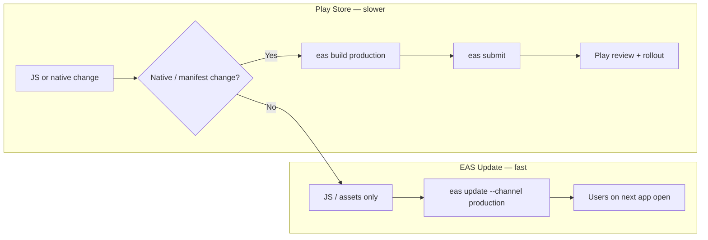

# Google Play — UnSpoil (`app.unspoil`)

Complete [EAS_SETUP.md](./EAS_SETUP.md) before your first cloud build.

| Item | Value |
|------|--------|
| Play package | `app.unspoil` |
| User-facing name | **UnSpoil** |
| EAS owner | `abhishekprograms` |
| EAS slug | `unspoil` → **@abhishekprograms/unspoil** |
| EAS project ID | In `app.json` / expo.dev project settings |

---

## 1. Google Play Console

Use a **Google Play Developer** account you control.

1. [Create app](https://play.google.com/console) → **UnSpoil** (or **UnSpoil: Expense Tracker**).
2. Set **Application ID** to `app.unspoil` (must match `app.json` exactly).
3. Complete **Dashboard** checklist: store listing, content rating, target audience, news app (No), COVID (No), Data safety, privacy policy URL, app access (full access), ads (No if none).

### Store listing (starter copy)

- **Short description:** Track spending and savings in NPR. Know what’s safe to spend each month.
- **Full description:** UnSpoil helps you plan monthly income across buckets, log expenses, track goals, and see safe-to-spend after salary — built for Nepal (NPR, eSewa-friendly payment helper). All data stays on your device; no account required.

Provide **phone screenshots** (1080×1920 or similar): Home, Transactions, Goals, Settings.

### Privacy policy (required)

Host a public HTTPS page stating: data stored locally on device; optional backup export/import by user; Payment Helper uses usage access + notifications only for chosen payment apps; no server collection. Link that URL in Play Console and optionally in-app later.

### Data safety (high level)

- **Collected:** None transmitted to developer servers (local-only app).
- **Optional features:** Usage access (Payment Helper), notifications — declare in form; explain in privacy policy.
- **Backup file:** User-initiated JSON on device / files they choose.

---

## 2. EAS build

```bash
eas whoami
# abhishekprograms — see EAS_SETUP.md
```

Production builds use **AAB** (Play requirement), no dev client (`app.config.js` strips `expo-dev-client` for `production` profile).

```bash
cd /path/to/unspoil
npm run eas:build:android:production
# or: eas build --platform android --profile production
```

**OTA:** Run `eas update:configure` so `updates.url` points at your EAS project. Production builds made **after** that can receive EAS Update.

Track builds on expo.dev → **abhishekprograms** → **unspoil** → **Builds**.

First build: EAS prompts for **Android keystore** — let EAS manage credentials (recommended).

---

## 3. Submit to Play

### One-time: Google Service Account

1. Play Console → **Setup → API access** → link Google Cloud project.
2. Create service account with **Release to production** (or Admin) → download JSON key.
3. Upload to EAS:

```bash
eas credentials --platform android
# Or during first: eas submit --platform android
```

### Submit

After production build finishes:

```bash
eas submit --platform android --profile production --latest
```

Or pick a build ID from the Expo dashboard. Choose **internal testing** first, then **production** when ready.

`eas.json` `"submit": { "production": {} }` uses default track; override with `--track internal` for first upload.

---

## 4. Release vs OTA (day‑to‑day flow)

Expo **EAS Update** on the free Hobby plan is enough for a personal app: publish JS/asset fixes in minutes with **no Play review**. Store builds are only when native code or permissions change.



| Change type | What to run | Play review? |
|-------------|-------------|--------------|
| UI, logic, copy, images (JS bundle) | `npm run eas:update:production -- --message "Fix …"` | No |
| New native module, SDK upgrade, `app.json` permissions/plugins, Kotlin plugin | Bump `expo.version` if needed → `npm run eas:build:android:production` → `npm run eas:submit:android` | Yes |
| Test build before store | `npm run eas:build:android:preview` + `npm run eas:update:preview` | N/A (internal APK) |

**Runtime version:** `"runtimeVersion": { "policy": "appVersion" }` ties updates to **`expo.version`** (e.g. `1.0.0`). OTAs for `1.0.0` only apply to store builds that were built as `1.0.0`. After you ship **`1.0.1`** as a new AAB, publish OTAs while still on `1.0.1` in `app.json`; bump version when you need a new native binary.

**Channels:** Production Play builds use channel **`production`** (`eas.json`). Preview/internal APKs use **`preview`**.

**When users get an update:** Default `expo-updates` checks on launch; the new bundle loads on the **next** cold start (usually seconds to a minute after you publish).

**CI (optional):** Set `EXPO_TOKEN` in GitHub Actions and run the same `eas update` / `eas build` commands non‑interactively.

---

## 5. After launch

1. **Ship JS fixes:** `npm run eas:update:production -- --message "Describe change"`.
2. **Ship native fixes:** production build + submit; `versionCode` auto-increments via `appVersionSource: remote`.
3. **Staged rollout:** Play Console → Production → increase rollout % after crash-free looks good.

---

## Checklist

- [ ] Play app created with `app.unspoil`
- [ ] Privacy policy URL live
- [ ] Data safety + content rating done
- [ ] Screenshots + listing text
- [ ] `eas update:configure` (OTA URL)
- [ ] `npm run eas:build:android:production`
- [ ] Service account linked to EAS
- [ ] `eas submit -p android --profile production --latest`
- [ ] Internal test → production rollout
- [ ] Verify OTA: `npm run eas:update:production -- --message "Test OTA"` on a test device
